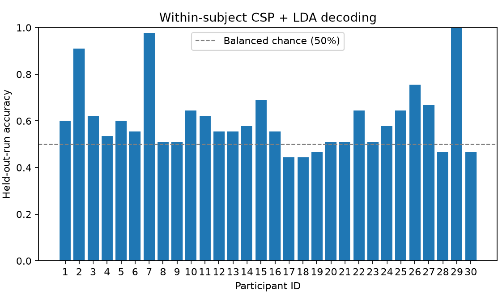
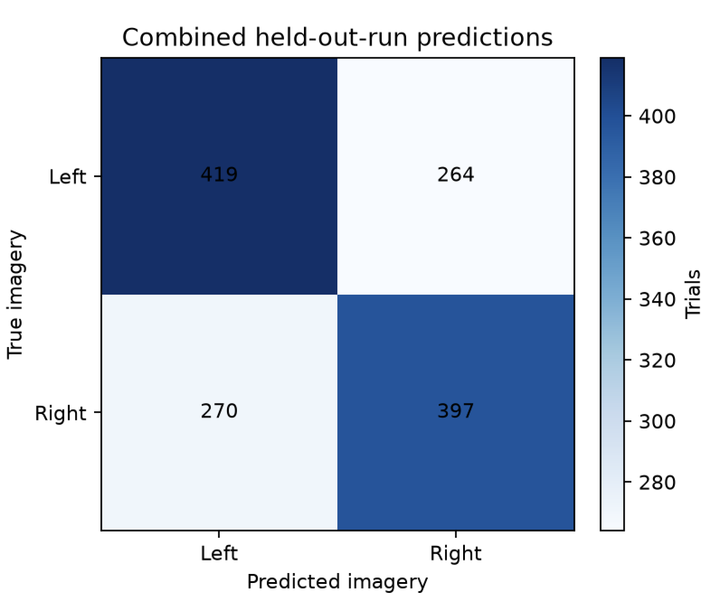

# EEG Motor Imagery Decoding with MNE-Python

An exploratory, reproducible analysis of **noninvasive EEG motor imagery** using the public [PhysioNet EEG Motor Movement/Imagery (EEGBCI) dataset](https://physionet.org/content/eegmmidb/1.0.0/).

This project studies event-related changes in mu/beta EEG power and decodes **imagined left versus right fist movement** using common spatial patterns (CSP) and linear discriminant analysis (LDA). It is an educational research portfolio project, **not** a clinical or real-time BCI.

## Methods

1. **Data:** Public EEGBCI recordings; the script defaults to participants 1–5, but supports any selected participants (IDs 1–109). For each participant, it uses **runs 4, 8, and 12**, the *imagined* left/right fist task. (Runs 3, 7, 11 represent **executed** movements and are not used.)
2. **Preprocessing:** Rename electrodes to standard names, apply a 1–40 Hz FIR bandpass filter and average reference, and epoch −1 to 4 seconds around each cue. A dedicated 60-Hz notch is omitted because 60 Hz is already outside the passband.
3. **Optional artifact handling:** `--ica` applies FastICA with candidate ocular-component detection using frontal EEG electrodes Fp1/Fp2 as proxies. These are **not EOG electrodes**: automated removal is heuristic and must be reviewed before making scientific claims. Disabled by default.
4. **Time–frequency analysis:** Morlet wavelet power from 8–30 Hz, expressed as percent change from the −0.8 to −0.2 s baseline (MNE fractional changes are multiplied by 100 to get actual percentage points). Contralateral-minus-ipsilateral event-related desynchronization (ERD) is summarized over 0.5–3.5 s (negative means stronger contralateral suppression).
5. **Motor imagery decoding:** Filter to 8–30 Hz, crop 0.5–3.5 s, and classify left/right trials with **CSP (4 components) + LDA**. CSP is fitted inside each training fold using a scikit-learn pipeline.
6. **Validation:** **Leave-one-run-out cross-validation within each participant.** Entire runs are held out instead of randomly splitting temporally related trials. Results do **not** establish performance on unseen participants.
7. **Exploratory group analysis:** One-sided sign-flip test on subject-level contralateral-minus-ipsilateral ERD (exact for up to 16 subjects; Monte Carlo with 20,000 samples above that). Statistical interpretation depends on the actual participants analyzed; more participants do not turn an exploratory analysis into a confirmatory study.

## Run locally

Python 3.10+ recommended.

```bash
# In the repository folder:
python -m venv .venv
source .venv/bin/activate          # On Windows: .venv\Scripts\activate
python -m pip install -r requirements.txt

# Default: participants 1–5, imagined fist movements, no ICA
python eeg_pipeline.py

# One participant to try first (downloads three EEG runs)
python eeg_pipeline.py --subjects 1

# Optional exploratory ocular ICA (slower; inspect exclusions)
python eeg_pipeline.py --ica

# Run automated tests without downloading the dataset
python -m pip install pytest
python -m pytest -q
```

The script **first checks `data/` recursively** for EDF recordings you already have. If any required runs are missing, MNE downloads only those files unless you pass `--local-only`. Internet is required only when files need to be downloaded. Raw recordings are **not committed** to the repository.

## Use EDF files you have already downloaded

Place your existing EDF recordings anywhere inside `data/` (either flat or in participant folders). For example:

```text
data/
├── S001/
│   ├── S001R04.edf
│   ├── S001R08.edf
│   └── S001R12.edf
└── S004/
    ├── S004R04.edf
    ├── S004R08.edf
    └── S004R12.edf
```

You may also leave all EDF files directly inside `data/` if that's easier. Keep each filename unchanged. **Only R04, R08, and R12 are analyzed**; R03/R07/R11 belong to motor execution, not motor imagery. You need all three imagery files for each participant selected. The example file `S004R04.edf` alone is not enough to complete run-held-out decoding; also provide `S004R08.edf` and `S004R12.edf`, or allow the script to download the missing runs.

```bash
# Use only files on your computer and process participant 4:
python eeg_pipeline.py --subjects 4 --local-only

# Analyze participants 1–5 using existing data (no downloads):
python eeg_pipeline.py --subjects 1 2 3 4 5 --local-only

# Specify a different data folder, including an absolute folder path:
python eeg_pipeline.py --data-dir "/path/to/your/EEG/data" --subjects 4 --local-only

# To automatically download only any missing recordings, omit --local-only:
python eeg_pipeline.py --subjects 4
```

If you see `Missing EDF files for subject ...`, either add the named files to the data directory or omit `--local-only`. Files already found locally will not be downloaded again.

## Analyze a larger cohort (example: 30 participants)

The CLI defaults to five participants **unless you pass `--subjects`**. To evaluate participants 1–30, use the following commands from the repository root. This requires **three imagery EDF recordings per participant** (90 files total).

```bash
# Optional: download recordings for participants 6–30 in parallel.
# Existing recordings are skipped; use this if you have 1–5 already.
python download_eeg_data.py --start 6 --end 30 --workers 5

# Analyze all 30 using recordings you already downloaded:
python eeg_pipeline.py --subjects $(seq 1 30) --local-only

# Alternatively: allow the analysis script to fetch any missing EDFs:
python eeg_pipeline.py --subjects $(seq 1 30)
```

The `$(seq 1 30)` shorthand works in macOS/Linux shells; on Windows, list participant IDs explicitly. `--local-only` prevents **all** downloads, so use it only once the corresponding recordings are present. The batch run saves updated **per-participant** results to `results/subject_results.csv`, a summary to `results/summary.json`, and group figures to `results/figures/`. The group accuracy is the **mean of participant-level held-out-run accuracies**, not a measure of performance on unseen participants.

## Results: 30 participants (exploratory)

A run on participants **1–30** with 90 EDF recordings (runs 4, 8, and 12; **1,350 trials**) yielded:

- **60.4%** mean held-out-run within-participant decoding accuracy (median **56.7%**).
- **44.4%–100.0%** participant accuracy range; **25 of 30** participants exceeded the 50% balanced-class chance level. This count is **not** a formal test of individual participant decoding significance.
- **816 of 1,350** trials were classified correctly across held-out runs (left: 419/683; right: 397/667).

These figures are the observed outputs of this pipeline, **not clinical results** and **not** evidence of generalization to previously unseen people. Particularly high scores for some participants may reflect neural information, subject/run artifacts, or other confounds; they require targeted quality checks before stronger conclusions. EEG artifact removal was **not** enabled for this run. The exploratory hemispheric laterality analysis uses a baseline-normalized percent-power change and should not be treated as a causal explanation of decoding performance.





The complete results, including all subject-level scores, can be reproduced locally with the command above. The TFR and laterality plots are generated when the script runs, and should be checked before presenting their interpretation as established findings.

The folder `data/` is excluded from GitHub by `.gitignore`; **don't upload the raw EDF files** to the repository.

## Interactive Jupyter notebook

An accompanying **[`eeg_analysis.ipynb`](eeg_analysis.ipynb)** walks through the signal analysis step by step. It reuses the functions in `eeg_pipeline.py` instead of replacing the reproducible command-line workflow. Run the notebook locally and save it to display preview figures from **S004R04** (raw waveforms, filtering, frequency spectrum, and time–frequency maps) on GitHub. These example images are **not cross-validated decoding results**.

From the repository folder, using your `eeg-bci` environment:

```bash
conda activate eeg-bci
python -m pip install -r requirements-notebook.txt
jupyter lab eeg_analysis.ipynb
```

In VS Code you may instead open `eeg_analysis.ipynb` directly and select the `eeg-bci` Python kernel. Keep the notebook working directory set to the repository root so it can find `data/` and `results/`.

1. The notebook defaults to **participant 4, run 4**. Change `SUBJECT = 4` at the top if you prefer another participant. It finds recordings inside `data/`, including participant subfolders.
2. The **signal exploration** sections need only one EDF (`S004R04.edf` for the default). The **held-out-run decoding** section needs *all three* imagery runs (`R04`, `R08`, and `R12`) for the chosen subject.
3. The **multi-participant exploration** sections (Sections 7–8) load **all participants present in** `results/subject_results.csv` from the command-line pipeline. To refresh them after downloading more EDF files, first run:

   ```bash
   python eeg_pipeline.py --subjects $(seq 1 30) --local-only
   ```

   Then select **Kernel → Restart Kernel and Run All Cells** in Jupyter. The earlier sections (1–6) still focus on **one selected example participant**, while Sections 7–8 use the full saved cohort. If your data include fewer subjects, use the IDs you have; 30 is a practical example, not a required sample size.

Raw EDF recordings and full generated results remain local (`data/`, `results/` are gitignored). The notebook is distributed with outputs cleared to avoid displaying stale figures; after running and verifying its plots locally, save it to display them on GitHub. This does not substitute for reproducing the full results.

## Outputs

Generated outputs are written to `results/` (gitignored):

```text
results/
├── subject_results.csv               # Trials, accuracy, class balance, ERD per subject
├── summary.json                      # Processing description, group statistics, caveats
└── figures/
    ├── example_motor_imagery_tfr.png # Contralateral time–frequency maps
    ├── held_out_run_accuracy.png     # Within-subject decoding accuracy
    ├── held_out_run_confusion.png    # Combined held-out-run predictions
    └── contralateral_erd.png         # Subject-level lateralization effects
```

The figures in the tracked `figures/` folder show the provided **30-participant** decoding results. Derived output files and EDFs are excluded by `.gitignore`, and the code regenerates figures under `results/figures/` on every run.

## Interpretation and limitations

- The recordings are **imagery**, not overt movement, because the correct run IDs are selected.
- The script defaults to five participants, but the reported analysis uses 30; the study cohort depends on the `--subjects` argument. Within-subject CV may still differ from truly prospective BCI performance.
- Frontal EEG channels can capture cortical activity as well as ocular contamination. The ICA option is a heuristic; it is not ground-truth validation.
- The ERD laterality analysis is exploratory; five participants are particularly underpowered, and increasing the cohort (e.g., to 30) does not remove the need for quality checks, appropriate statistical interpretation, and independent validation.
- Bandpass and artifact-processing decisions affect signal and decoding estimates. Review per-recording quality before drawing scientific conclusions.
- This implementation emphasizes **offline** EEG analysis and classification, not real-time control, clinical use, or across-participant transfer.

## Data source / citation

Dataset: [EEG Motor Movement/Imagery Dataset, PhysioNet](https://physionet.org/content/eegmmidb/1.0.0/).

For related original BCI system/dataset publications, see:

- Schalk G, McFarland DJ, Hinterberger T, Birbaumer N, Wolpaw JR. BCI2000: a general-purpose brain-computer interface (BCI) system. *IEEE Trans Biomed Eng*. 2004;51(6):1034–1043. [doi:10.1109/TBME.2004.827072](https://doi.org/10.1109/TBME.2004.827072)
- Goldberger AL, et al. PhysioBank, PhysioToolkit, and PhysioNet: Components of a new research resource for complex physiologic signals. *Circulation*. 2000. [doi:10.1161/01.CIR.101.23.e215](https://doi.org/10.1161/01.CIR.101.23.e215)

See also the [MNE motor imagery CSP example](https://mne.tools/stable/auto_examples/decoding/decoding_csp_eeg.html).

## Development note

This project involved AI-assisted coding and documentation. Its analysis, parameters, and interpretations should be independently reviewed and validated before being used for scientific conclusions.

## License

No software license has been assigned. Add a license of your choice before publishing if you want to explicitly permit reuse.
